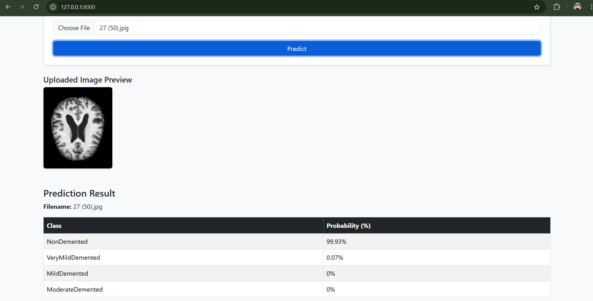

# Deep CNN Classification of Alzheimer's Disease Stages from MRI

**A robust, lightweight custom Convolutional Neural Network for four‑class staging of Alzheimer's Disease from brain MRI, served through a FastAPI web application.**

This repository contains both the **research** (the custom CNN, the transfer‑learning baselines, and the experiments behind our manuscript) and a ready‑to‑run **implementation** — a FastAPI service that serves the trained model for real‑time prediction. **The trained model is bundled in the repo, so the app runs out of the box.**

<p align="center">
  
  
  
  
</p>

> ### 🏆 Headline result
> A compact custom CNN (**~1.32 M** parameters) classifies the four AD stages
> — **MildDemented · ModerateDemented · NonDemented · VeryMildDemented** —
> reaching **~100% test accuracy** with **100% precision / recall / F1**, while using
> **far fewer trainable parameters** than the VGG16 (96%) and MobileNetV2 (97%) transfer‑learning baselines.

---

## Table of contents

1. [Motivation](#1-motivation)
2. [Research contribution](#2-research-contribution)
3. [Proposed architecture](#3-proposed-architecture)
4. [Dataset & preprocessing](#4-dataset--preprocessing)
5. [Results](#5-results)
6. [Repository structure](#6-repository-structure)
7. [Web implementation (FastAPI)](#7-web-implementation-fastapi)
8. [Getting started](#8-getting-started)
9. [API reference](#9-api-reference)
10. [Reproducing the research](#10-reproducing-the-research)
11. [Limitations & future work](#11-limitations--future-work)
12. [Citation](#12-citation)
13. [Authors & funding](#13-authors--funding)

---

## 1. Motivation

Alzheimer's Disease (AD) is an incurable, progressive neurodegenerative disorder and a leading cause of dementia. The WHO lists it among the top causes of death worldwide, and tens of millions of people live with AD today. Crucially, the **early stages are treatable** — so accurately identifying a patient's stage from **MRI** materially affects their care plan.

In practice, MRI staging is done manually by trained radiologists. That is **slow, expertise‑dependent, and error‑prone**, and in many countries specialists are in short supply. This project builds an **automatic, accurate, and computationally inexpensive** deep‑learning classifier that predicts the AD stage directly from an MRI slice, so it can serve as a fast, low‑cost second opinion.

## 2. Research contribution

We designed and evaluated three deep‑learning classifiers for four‑class AD staging and compared a **custom CNN built from scratch** against two **transfer‑learning** baselines:

- **Custom lightweight CNN (proposed).** A compact network (four Conv2D layers across three convolutional blocks plus a classification head, ~1.32 M parameters, only **256 non‑trainable**) tailored to the MRI data. It achieves the **highest accuracy with the fewest trainable parameters**, making it deployable on modest hardware.
- **Transfer‑learning baselines.** **VGG16** and **MobileNetV2** with their top layers removed and replaced by global‑average‑pooling, dropout, and dense layers, fine‑tuned for the four AD classes.
- **Class‑imbalance handling via augmentation.** The dataset is heavily imbalanced (the *ModerateDemented* class has only 64 images). Training‑time augmentation is used to balance class variability and curb overfitting.

The proposed CNN outperforms both pre‑trained baselines while being **the smallest model**, and it surpasses the accuracies reported by a range of prior machine‑learning and deep‑learning studies on this task.

## 3. Proposed architecture

The custom CNN takes a **128×128×3** MRI image and outputs a probability distribution over the four AD stages via a softmax layer. It is trained with the **sparse categorical cross‑entropy** loss.

| Layer | Output shape | Parameters |
|---|---|---:|
| Conv2D (input) | 128×128×64 | 1,792 |
| MaxPooling2D | 64×64×64 | 0 |
| Conv2D | 64×64×64 | 36,928 |
| MaxPooling2D | 32×32×64 | 0 |
| Dropout (0.2) | 32×32×64 | 0 |
| Conv2D | 32×32×128 | 73,856 |
| BatchNormalization | 32×32×128 | 512 |
| MaxPooling2D | 16×16×128 | 0 |
| Conv2D | 16×16×128 | 147,584 |
| MaxPooling2D | 8×8×128 | 0 |
| Dropout (0.2) | 8×8×128 | 0 |
| Flatten | 8,192 | 0 |
| Dense (ReLU) | 128 | 1,048,704 |
| Dense (ReLU) | 64 | 8,256 |
| Dense (softmax) | 4 | 260 |
| **Total** | | **1,317,892** |
| **Trainable** | | **1,317,636** |
| **Non‑trainable** | | **256** |

**Design notes.** Each convolutional block uses 3×3 kernels (stride 1, "same" padding) followed by ReLU and max‑pooling. Block 1 and Block 3 apply 20% dropout; Block 2 uses batch normalization instead, reducing internal covariate shift for faster, more stable convergence. The very small share of non‑trainable parameters (256 of ~1.32 M) keeps the model expressive without inviting overfitting.

**Training configuration**

| Setting | Value |
|---|---|
| Loss | Sparse categorical cross‑entropy |
| Output | Softmax over 4 classes |
| Epochs | 200 |
| Batch size | 64 |
| Learning rate | 0.0001 |
| Input size | 128×128 |

The training/validation curves show validation loss staying above training loss without divergence for the custom CNN, indicating **no overfitting** despite the small dataset.

## 4. Dataset & preprocessing

- **Dataset:** [kaggle](https://www.kaggle.com/datasets/uraninjo/augmented-alzheimer-mri-dataset-v2) — *Alzheimer's Dataset (4 class of images)* — **6,400** brain‑MRI images, 176×208, grayscale.
- **Classes (imbalanced):** NonDemented (3,200) · VeryMildDemented (2,240) · MildDemented (896) · **ModerateDemented (64)**.
- **Preprocessing:** resize to **128×128**, shuffle, and normalize pixel values to **0–1**.
- **Split:** ~80 / 10 / 10 → **5,119 train / 642 validation / 642 test**.
- **Augmentation (training only):** 30° rotation, horizontal mirroring, width/height shift (0.1), and horizontal flip — applied to counter class imbalance (especially *ModerateDemented*) and reduce overfitting.

## 5. Results

### 5.1 Model comparison (test set)

| Model | Trainable parameters | Test accuracy |
|---|---:|:---:|
| VGG16 (transfer learning) | 4,371,492 | 96% |
| MobileNetV2 (transfer learning) | 10,662,948 | 97% |
| **Custom CNN (proposed)** | **1,317,636** | **100%** |

The custom CNN is the **most accurate and the smallest** model — roughly **⅓** the trainable parameters of VGG16 and **⅛** of MobileNetV2.

### 5.2 Per‑class performance

**Custom CNN** — precision, recall, and F1 of **100%** across classes; effectively all 642 test images classified correctly (a single *NonDemented* sample was the only near‑miss).

Per‑class recall for the baselines highlights where the imbalance bites — the tiny *ModerateDemented* class:

| Class | MobileNetV2 | VGG16 |
|---|:---:|:---:|
| MildDemented | 95% | 93% |
| ModerateDemented | 71% | 86% |
| NonDemented | 98% | 98% |
| VeryMildDemented | 97% | 96% |

### 5.3 Comparison with prior work

| Reference | Method | Accuracy |
|---|---|:---:|
| Antor et al. | SVM | 92.00% |
| Acharya et al. | Shearlet Transform + KNN | 94.54% |
| Nawaz et al. | KNN / SVM / RF | 84.93% |
| Hussain et al. | Custom CNN | 97.75% |
| Fu'adah et al. | AlexNet | 95.00% |
| Turkson et al. | Spiking Neural Network | 90.00% |
| Fanar et al. | AlzNet (custom CNN) | 99.30% |
| Oh et al. | Convolutional Autoencoder | 86.60% |
| Bijen et al. | AlexNet | 94.00% |
| Maqsood et al. | AlexNet | 92.85% |
| Hamza et al. | XAI + VGG16 | 86.82% |
| Alsaeed et al. | ResNet50 + SVM/RF | 85.70% |
| Li et al. | 3‑D CNN | 95.06% |
| **This work** | **Custom CNN** | **100%** |

Evaluation used **accuracy, precision, recall, F1‑score, and confusion matrices** on the held‑out test set.

## 6. Repository structure

```
FastAPI_Alzheimer_classification/
├── app/
│   ├── main.py            # FastAPI app — GET "/" (portal) and POST "/predict/"
│   ├── utils.py           # image preprocessing + top‑4 class/probability formatting
│   ├── updated_model.h5   # ✅ trained model (bundled, ~5.3 MB) — no download needed
│   └── templates/
│       └── index.html     # Bootstrap portal: upload → preview → results table
├── image.png              # portal screenshots
├── image-1.png
├── Dockerfile             # containerized serving (python:3.10‑slim)
├── requirements.txt       # pinned dependencies (TensorFlow, FastAPI, etc.)
└── README.md
```

> ℹ️ Unlike many DL repos, the trained Keras model **ships inside the repository** (`app/updated_model.h5`), so you can clone and run the API immediately. Training itself was performed in **Google Colab** (GPU); see the manuscript for the full experimental methodology.

## 7. Web implementation (FastAPI)

The `app/` package wraps the trained network in a small inference service:

- **`main.py`** loads `updated_model.h5` once at startup, serves the upload portal at `/`, and exposes `POST /predict/`, returning the four classes ranked by probability.
- **`utils.py`** runs the inference pipeline: decode the uploaded image → resize to 128×128 → reshape to `(1, 128, 128, 3)` → normalize to 0–1 → `model.predict` → sort the four class probabilities in descending order and format them as percentages.
- **`templates/index.html`** is a Bootstrap page that previews the uploaded MRI and renders a **Class → Probability (%)** results table. It notes that the model is reliable only for the four AD MRI categories it was trained on.

## 8. Getting started

### 8.1 Clone

```bash
git clone https://github.com/mdparvex/FastAPI_Alzheimer_classification.git
cd FastAPI_Alzheimer_classification
```

The trained model is already present at `app/updated_model.h5` — nothing else to download.

### 8.2 Run locally

Create and activate a virtual environment:

```bash
# Windows
python -m venv venv
venv\Scripts\activate

# macOS / Linux
python3 -m venv venv
source venv/bin/activate
```

Install dependencies and start the server:

```bash
pip install -r requirements.txt
uvicorn app.main:app --reload
```

Open **http://127.0.0.1:8000/**, upload a brain‑MRI image, and view the predicted stage with per‑class probabilities.

### 8.3 Run with Docker

```bash
docker build -t alzapp:latest .
docker run -d -p 8000:8000 alzapp:latest
```

Then browse to **http://127.0.0.1:8000/**.

## 9. API reference

### `POST /predict/`

Upload a brain‑MRI image and receive the ranked AD‑stage predictions.

**Request** — `multipart/form-data`

| Field | Type | Notes |
|---|---|---|
| `file` | image | `.jpg`, `.jpeg`, `.png`, or `.jfif` |

```bash
curl -X POST "http://127.0.0.1:8000/predict/" \
  -F "file=@your_mri_image.jpg"
```

**Response** — `200 OK`

```json
{
  "filename": "your_mri_image.jpg",
  "predictions": {
    "class1": "NonDemented",     "prob1": 98.7,
    "class2": "VeryMildDemented","prob2": 1.1,
    "class3": "MildDemented",    "prob3": 0.15,
    "class4": "ModerateDemented","prob4": 0.05
  },
  "message": "File uploaded successfully"
}
```
# Play with the portal
Choose images from the test images folder


Classes are returned **ranked from most to least likely**, with probabilities as percentages. Errors return `400` (unsupported file type) or `500` (inference failure) with a `message`.

## 10. Reproducing the research

1. Download the **Alzheimer's Dataset (4 class of images)** from Kaggle.
2. Preprocess (resize to 128×128, shuffle, normalize) and split 80/10/10.
3. Apply training‑time augmentation (rotation, mirroring, shifts, flips) to rebalance the classes.
4. Train the three models under the same protocol (200 epochs, batch 64, LR 1e‑4): the custom CNN from scratch, plus VGG16 and MobileNetV2 with fine‑tuned classification heads.
5. Evaluate with accuracy, precision, recall, F1, and confusion matrices. Export the best model to `app/updated_model.h5` to serve it via the API.

The experiments were developed in **Google Colab** with Python and TensorFlow/Keras.

## 11. Limitations & future work

- **Single‑source dataset.** All images come from one Kaggle dataset; the near‑perfect test accuracy should be confirmed with **external validation** on independent AD MRI cohorts before clinical claims.
- **Class imbalance.** *ModerateDemented* has only 64 original images — augmentation helps, but more real data would strengthen this class.
- **Larger and richer data.** A larger, more diverse public dataset (and 3‑D volumetric MRI rather than 2‑D slices) is a natural next step.
- **Clinical evaluation.** Prospective testing with radiologists is needed to assess real‑world reliability and integration into diagnostic workflows.

## 12. Citation

If you use this code or model, please cite the accompanying manuscript:

> Md. Abdulla Al Mamun, Tanjil Mahmud, and Mohammad Monirujjaman Khan.
> *Classification of Stages of Alzheimer Disease using Robust and Efficient Deep Convolutional Neural Network.*
> Department of Electrical and Computer Engineering, North South University, Dhaka, Bangladesh.

```bibtex
@article{almamun_ad_cnn,
  title   = {Classification of Stages of Alzheimer Disease using Robust and
             Efficient Deep Convolutional Neural Network},
  author  = {Al Mamun, Md. Abdulla and Mahmud, Tanjil and
             Khan, Mohammad Monirujjaman},
  institution = {North South University},
  note    = {Manuscript}
}
```

## 13. Authors & funding

Department of Electrical and Computer Engineering, North South University, Bashundhara R/A, Dhaka 1229, Bangladesh.

- Md. Abdulla Al Mamun
- Tanjil Mahmud
- Mohammad Monirujjaman Khan *(corresponding author)*

**Funding.** Supported by the North South University CTRG Research Grant (**CTRG‑21‑SEPS/24**), North South University, Bashundhara, Dhaka, Bangladesh.

For questions about the implementation, please open an issue on the [repository](https://github.com/mdparvex/FastAPI_Alzheimer_classification).

---

*Dataset: the Alzheimer's four‑class MRI dataset is publicly available on Kaggle for research use.*
